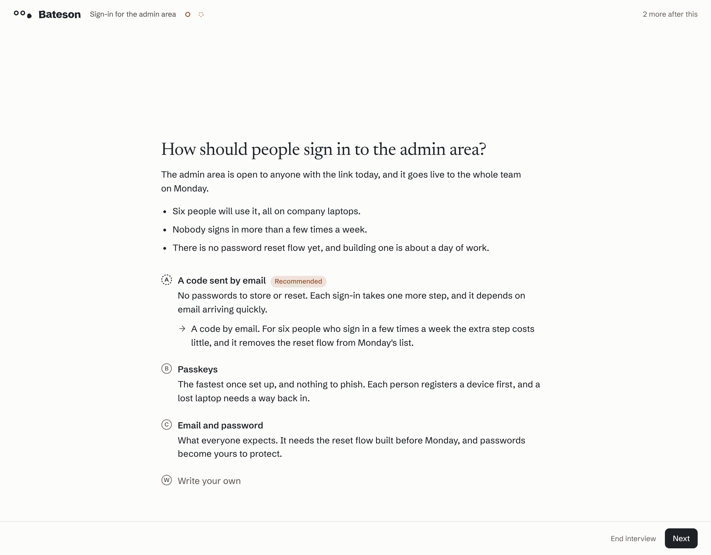

# bateson

a window where your coding agents ask you things, one at a time, and wait for the answer.

<picture>
  <source media="(prefers-color-scheme: dark)" srcset="docs/screenshot-dark.png">
  
</picture>

i'm [jonas](https://github.com/jfenger1337). i do most of my work by letting claude code interview me first, until every decision that matters is mine. a terminal is a poor place for that: long questions scroll past, and with several agents running, one waits on me for an hour while another guesses and builds on the guess.

so when an agent needs me, it sends the question to bateson and stops. i answer in one window, and the agent picks up with my answer, even hours later. every question has a few options and the agent's pick with its reasons. taking it is one key. it all runs locally: the queue is a folder (`~/.bateson`) and nothing of yours is sent anywhere. the one thing bateson asks the internet is, once a day, whether github has a newer version of it (you can turn that off in settings).

it's built for one person on a mac using claude code. it runs on windows too (CI installs and uninstalls it there on every push), but i don't use it there daily, so tell me if something breaks. fork it, change it, PRs welcome.

## install

you need macOS or Windows 10/11, node 22.18+, and [claude code](https://claude.com/claude-code). it's early, and the installer adds hooks to every claude code session on your machine.

the easy way is to paste this into a claude code session:

```
install bateson for me from https://github.com/jfenger1337/bateson.

- clone it into ~/bateson and follow docs/install.md in the repository.
- before you change anything outside ~/bateson, tell me what you will change and wait for my yes.
- if a step fails, stop and tell me what failed and what would fix it. don't install or upgrade anything else to get past it.
- if ~/bateson already holds bateson, update it and run the installer again.
```

or by hand (same commands in powershell):

```bash
git clone https://github.com/jfenger1337/bateson.git ~/bateson
cd ~/bateson
npm install
npm run build
node scripts/install.ts --login
```

you get the `bateson` command, the skills, the hooks in `~/.claude/settings.json` (backed up first), and the server started at login. keep the folder where it is. when there's a new version, bateson says so on its empty screen, and **update** in settings installs it and restarts. it won't touch a folder where you've changed files or made commits of your own: there, `git pull`, `npm run build` and the installer again do the same by hand.

## get started

1. open http://localhost:4848. on a mac you can build the app for notifications, a count and a hotkey: `./mac/build.sh --install`. on windows bateson is that page in your browser, and an agent that asks you something opens it if it isn't open already; the windows app is retired for now.
2. in a new claude code session, run [`/setup-bateson`](./skill/setup-bateson/SKILL.md) to choose what agents bring you.
3. work as usual. agents send on their own when they hit a call that's yours. you can also ask, e.g. `/ama i want to add team accounts. ask me anything before you build.`

if you closed the terminal that asked, the next session in the same repository gets the answer.

## what can come to you

| kind | what you see | on by default |
|---|---|---|
| decisions | two to four options per question, with the agent's recommendation. | yes |
| taste calls | the same, for copy, naming, anything where right means you like it. | yes |
| plans | the plan before big work. approve or send back with a note. | no |
| findings | review findings one at a time. keep, dismiss or comment. | no |
| code | the diff. comment on lines, then approve or send back. | no |

## skills

- [`/ama`](./skill/ama/SKILL.md): the agent interviews you, a round at a time, before work starts.
- [`/setup-bateson`](./skill/setup-bateson/SKILL.md): change what agents bring you.
- [`bateson`](./skill/bateson/SKILL.md): loaded by agents, not you. it tells them when and how to ask. edit it to change how they write to you.

if you use matt pocock's grill skills, the installer points your `grilling` skill at `/ama` and restores yours on uninstall.

## which agents

claude code only, for now: it's the one that can end its turn and be woken by your answer through plain settings. codex is planned, no date. cloud sessions can't reach your queue.

the queue is plain files and `bateson` works from any shell. to build an integration for another agent, see [`docs/other-agents.md`](./docs/other-agents.md) and [`CONTRIBUTING.md`](./CONTRIBUTING.md).

## more

- [`docs/concept.md`](./docs/concept.md): what bateson is for.
- [`docs/reference.md`](./docs/reference.md): keys, settings, how it works, and running it against a scratch queue.
- [`docs/folder-format.md`](./docs/folder-format.md): the contract on disk.

## uninstall

```bash
node scripts/install.ts --uninstall
```

removes everything the installer added and restores `~/.claude/settings.json`. your queue in `~/.bateson` and the settings backups stay.

## license

MIT, see [LICENSE](LICENSE). fonts in `web/public/fonts/` are under the SIL open font license 1.1.

asking in rounds grew out of matt pocock's `grilling` skill, and the way `/ama` frames and sorts its questions comes from poteto's pstack. thank you both.

named after gregory bateson, who saw a mind as a loop that includes the things it works on.
